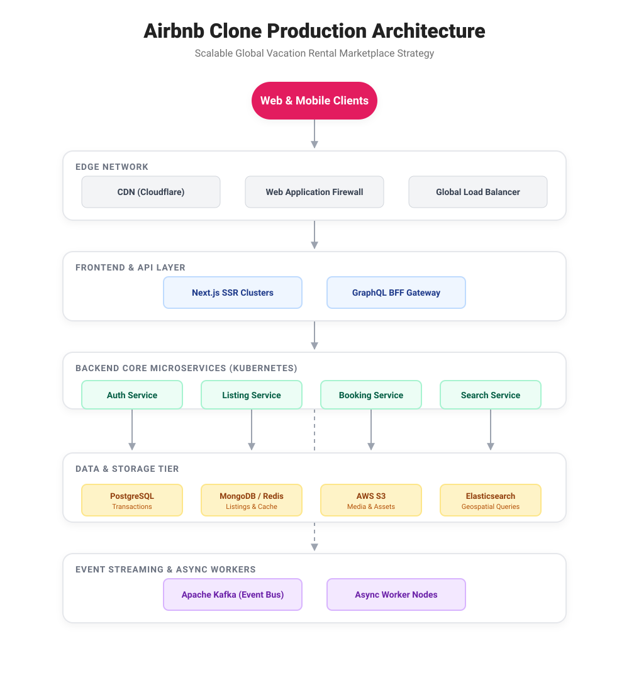
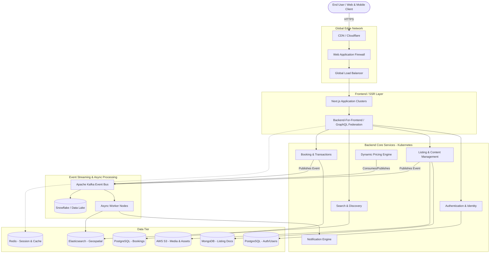

# Production-Scale Vacation Rental Marketplace Architecture

This document outlines the high-level architecture and scaling strategy for a global vacation-rental marketplace (analogous to Airbnb). It is designed to handle millions of concurrent users, massive global media delivery, high-throughput search queries, and secure, transactional bookings.

## 1. High-Level Architecture Diagram

---

## 2. Scaling Strategy Breakdown

To operate at a global production scale, each tier of the architecture implements specific strategies for high availability, fault tolerance, and horizontal scalability.

### A. Frontend Scaling Strategy
* **Global Content Delivery (CDN):** All static assets (images, fonts, JS bundles) are heavily cached at the edge (e.g., Cloudflare/AWS CloudFront). This drops origin server load by >80%.
* **Server-Side Rendering (SSR) / Incremental Static Regeneration (ISR):** Using Next.js, listing pages are pre-rendered and statically cached at the edge, drastically reducing database load while maintaining perfect SEO and lightning-fast Time-to-First-Byte (TTFB).
* **Stateless Clusters:** Frontend node clusters are entirely stateless, allowing them to horizontally auto-scale based on CPU utilization during traffic spikes (e.g., holiday booking seasons).

### B. Backend Scaling Strategy
* **Microservices Architecture:** The backend is decoupled into independent domains (Auth, Listings, Bookings, Search). If the Search service experiences a massive spike in traffic, it can scale independently without affecting the Booking service's stability.
* **Backend-for-Frontend (BFF):** A GraphQL Federation layer aggregates data from multiple microservices so the client only needs to make a single HTTP request, minimizing latency over poor mobile networks.
* **Event-Driven Asynchronous Processing:** Heavy tasks (like sending confirmation emails, updating search indexes, or syncing analytics) are pushed to an **Apache Kafka** event bus. Worker nodes consume these events asynchronously, keeping the main HTTP response cycle incredibly fast.

### C. Storage & Database Scaling Strategy
* **Polyglot Persistence:** Different databases are used for their specific strengths:
  * **PostgreSQL:** Used for transactional data requiring strict ACID compliance (Bookings, Payments, User Identity). Scaled using read-replicas to offload read-heavy dashboard queries.
  * **MongoDB:** Used for flexible, document-based listing data where schemas frequently evolve.
  * **Redis:** In-memory caching for session management, API rate limiting, and caching the most frequently accessed listing metadata.
* **Object Storage (S3):** All property images and user media are stored in horizontally infinitely scalable object storage buckets, served securely through the CDN.

### D. Search Scaling Strategy
* **Geospatial Indexing:** To support complex map-based bounding-box queries (e.g., "Find all villas in this map area under $200"), raw listing data is synced asynchronously from the main database into an **Elasticsearch** (or OpenSearch) cluster.
* **Sharding & Replication:** The search index is partitioned across multiple shards and heavily replicated. This allows the system to handle thousands of complex read-queries per second, routing traffic to the nearest healthy shard.

### E. Deployment & CI/CD Strategy
* **Containerization (Docker & Kubernetes):** All microservices and frontend nodes are packaged into immutable Docker containers and orchestrated via Kubernetes (EKS/GKE). This provides auto-healing (restarting failed pods) and dynamic auto-scaling.
* **Zero-Downtime Deployments:** Updates are pushed using Rolling Updates or Blue/Green deployment strategies, ensuring users never experience downtime during continuous delivery cycles.
* **Infrastructure as Code (IaC):** Environments are provisioned using Terraform, ensuring that staging and production clusters remain identical and reproducible in minutes during disaster recovery scenarios.
